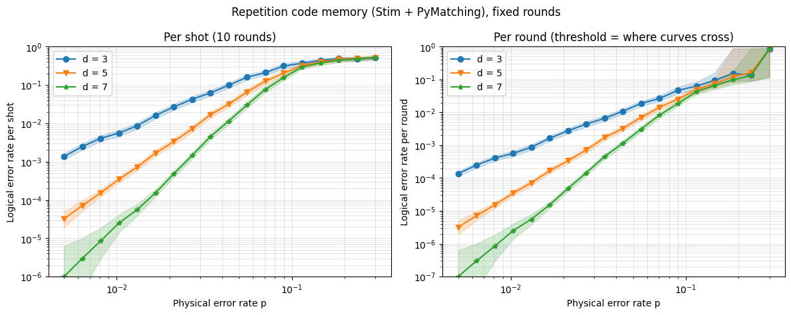

# Repetition Code Memory Simulation (Stim + PyMatching)

Simulation of a quantum repetition code with circuit-level noise, to study how
the logical error rate changes with code distance.

## What I did
- Built repetition-code memory circuits with Stim (distances 3, 5 and 7, with
  3 x distance rounds of syndrome measurement)
- Decoded the syndrome data with PyMatching (minimum-weight perfect matching)
- Measured the logical error rate for physical error rates p from 0.01 to 0.2
- Noise model: depolarizing noise on data qubits, plus measurement flip and
  reset flip errors, all with probability p

## Result

- Below p of about 0.1, larger distance gives a lower logical error rate
  (error suppression).
- Around p of 0.095 to 0.10 the curves meet. This is the threshold for this
  simple noise model.
- Above the threshold, larger codes do slightly worse, and all curves approach
  0.5 (a coin flip).
- The threshold of about 10% belongs to this simplified model. Real surface-code
  thresholds on hardware are closer to 1%.
- The d = 7 point at p = 0.01 comes from very few logical errors, so its
  statistical uncertainty is large.

## How to run
Open the notebook in Google Colab or Jupyter and run all cells.
Install the libraries with: pip install stim pymatching numpy matplotlib

## Tools
Python, Stim, PyMatching, NumPy, Matplotlib
